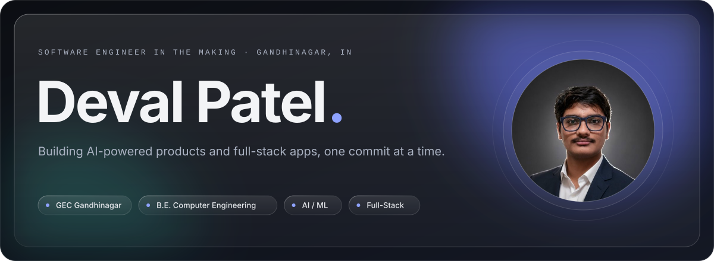
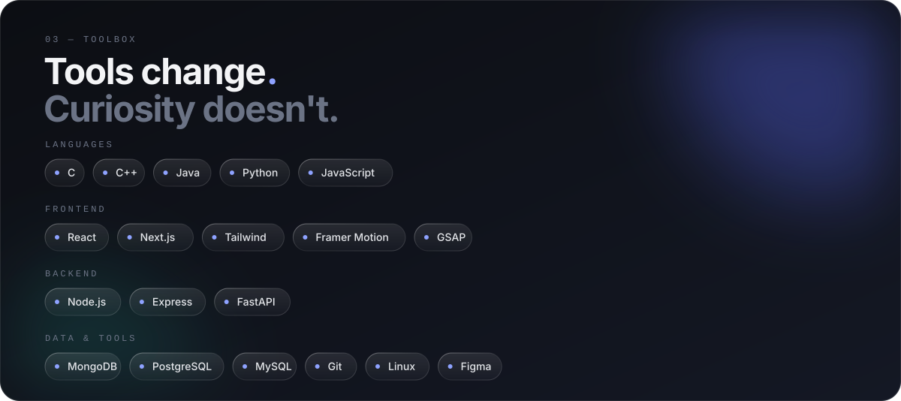

  

 

 

 

 

---

## 🏆 My GitHub Score, updated daily:

<!--SCORE_START-->
🏆 **GitHub Score:** 1070

📊 Formula: (Commits ×0.5 + Stars ×5 + Forks ×3 + PRs ×4 + Issues ×2 + Followers ×2)

🎮 **Level 2**
[▓░░░░░░░░░] 14%
<!--SCORE_END-->

---

<picture>
  <source media="(prefers-color-scheme: dark)" srcset="https://gh.crafter.run/DEVAL-020?theme=dark&detail=80" />
  <source media="(prefers-color-scheme: light)" srcset="https://gh.crafter.run/DEVAL-020?theme=light&detail=80" />
  
</picture>

 
 

- 📫 How to reach 
me: **pateldeval6050@gmail.com**

---

## 📈 GitHub Analytics:

 

## 📊 Contribution Graph:

---

## 🐍 Contribution Snake:

<picture>
<source media="(prefers-color-scheme: dark)" srcset="https://raw.githubusercontent.com/platane/snk/output/github-contribution-grid-snake-dark.svg">
<source media="(prefers-color-scheme: light)" srcset="https://raw.githubusercontent.com/platane/snk/output/github-contribution-grid-snake.svg">

</picture>

---

## Total Profile View:

--- 

---

<!-- 

   -->

 

 

 <h3> ⭐ Feel free to explore my repositories and projects!
  
   If you like my work, consider giving a ⭐ to my repositories and you can use by fork them, 
    
   I'm always open to collaborating on interesting projects, discussing AI/ML innovations.
 </h3>

> "Ship beats perfect" - Currently exploring how AI changes everything about software development.

Random Facts

- Run 3-6 Claude instances concurrently
- Plays cricket
- Loves watching movies

---

 

---

